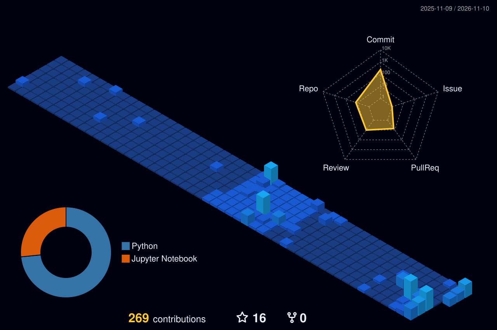

<!-- HERO: animated intro -->

  

 

<!-- MY MAGE WAY -->

  

<!-- SPELL ARSENAL -->

  

<!-- MAGE REGISTRATION + QUEST DASHBOARD -->

  

## ✦ S-Rank Quests

<!-- QUESTS:START -->
<table>
<tr><th>Quest</th><th>What it is</th><th>Spells used</th><th align="center">⭐</th></tr>
<tr><td><a href="https://github.com/BerkeArdaTurk21/foldsafe"><b>foldsafe</b></a></td><td>Static analyzer and agent skill that catch data leakage in ML code</td><td><code>Python</code> <code>static analysis</code></td><td align="center"><b>0</b></td></tr>
<tr><td><a href="https://github.com/BerkeArdaTurk21/kaggle-titanic"><b>Kaggle Titanic</b></a></td><td>Leak-free pipelines and nested CV · Kaggle 0.794</td><td><code>scikit-learn</code> <code>XGBoost</code></td><td align="center"><b>0</b></td></tr>
<tr><td><a href="https://github.com/BerkeArdaTurk21/customer-churn-shap-dashboard"><b>Churn SHAP Dashboard</b></a></td><td>XGBoost churn model with a SHAP why for every prediction</td><td><code>XGBoost</code> <code>SHAP</code> <code>Streamlit</code></td><td align="center"><b>0</b></td></tr>
<tr><td><a href="https://github.com/BerkeArdaTurk21/Stock-Sentiment-Predictor"><b>Stock Sentiment</b></a></td><td>Three-class sentiment on 4,846 financial headlines</td><td><code>NLP</code> <code>scikit-learn</code></td><td align="center"><b>0</b></td></tr>
<tr><td><a href="https://github.com/BerkeArdaTurk21/EconoScope"><b>EconoScope</b></a></td><td>Inflation in 212 countries, 1970-2022</td><td><code>pandas</code> <code>EDA</code></td><td align="center"><b>0</b></td></tr>
<tr><td><a href="https://github.com/BerkeArdaTurk21/Python-RoadMap"><b>Python RoadMap</b></a></td><td>Eight weeks of daily lessons, quizzes and four projects</td><td><code>Python</code></td><td align="center"><b>16</b></td></tr>
</table>

<a href="https://github.com/BerkeArdaTurk21?tab=repositories"><b>→ See all 14 repositories</b></a>
<!-- QUESTS:END -->

  

### 🌌 My contribution realm

*Every commit raises another tower, rebuilt automatically every day.*

  

<!-- JOIN THE GUILD -->

  

 

**Baseline first, keep learning, keep shipping.** ✦

