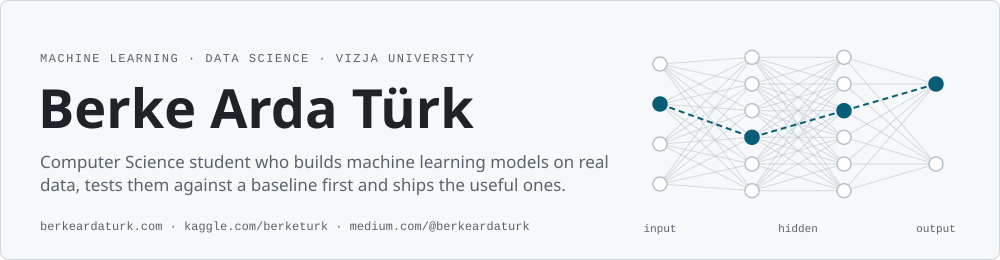
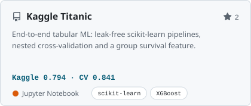
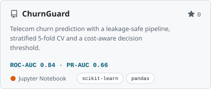
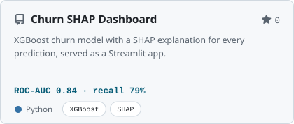
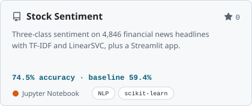
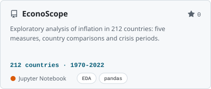
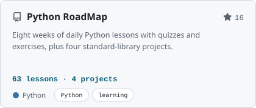
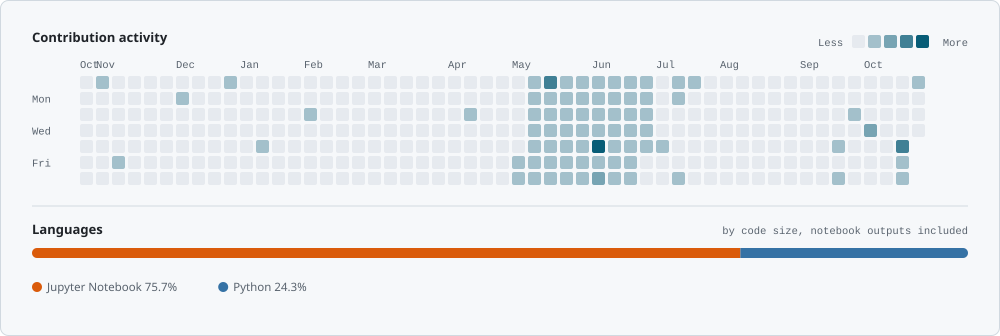

<a href="https://berkeardaturk.com">
  <picture>
    <source media="(prefers-color-scheme: dark)" srcset="./assets/header-dark.svg">
    
  </picture>
</a>

  <a href="https://berkeardaturk.com"><b>Website</b></a>&nbsp;&nbsp;·&nbsp;&nbsp;
  <a href="https://www.linkedin.com/in/berke-arda-turk/"><b>LinkedIn</b></a>&nbsp;&nbsp;·&nbsp;&nbsp;
  <a href="https://www.kaggle.com/berketurk"><b>Kaggle</b></a>&nbsp;&nbsp;·&nbsp;&nbsp;
  <a href="https://medium.com/@berkeardaturk"><b>Medium</b></a>&nbsp;&nbsp;·&nbsp;&nbsp;
  <a href="mailto:turkberkearda@gmail.com"><b>Email</b></a>

## About

I'm a Computer Science undergraduate at Vizja University, specialising in AI and Data Science. I like taking a real dataset all the way to an honest answer: a simple baseline first, validation without leakage, and a clear note on what the model cannot do. The results that hold up become apps and write-ups.

- **Focused on** machine learning on tabular data, model explainability and big data with PySpark.
- **Writing** about my data projects on [Medium](https://medium.com/@berkeardaturk).
- **Open to** machine learning and data roles.

## Featured work

  <a href="https://github.com/BerkeArdaTurk21/kaggle-titanic"><picture><source media="(prefers-color-scheme: dark)" srcset="./assets/card-kaggle-titanic-dark.svg"></picture></a>
  <a href="https://github.com/BerkeArdaTurk21/ChurnGuard"><picture><source media="(prefers-color-scheme: dark)" srcset="./assets/card-churnguard-dark.svg"></picture></a>
  <a href="https://github.com/BerkeArdaTurk21/customer-churn-shap-dashboard"><picture><source media="(prefers-color-scheme: dark)" srcset="./assets/card-customer-churn-shap-dashboard-dark.svg"></picture></a>
  <a href="https://github.com/BerkeArdaTurk21/Stock-Sentiment-Predictor"><picture><source media="(prefers-color-scheme: dark)" srcset="./assets/card-stock-sentiment-predictor-dark.svg"></picture></a>
  <a href="https://github.com/BerkeArdaTurk21/EconoScope"><picture><source media="(prefers-color-scheme: dark)" srcset="./assets/card-econoscope-dark.svg"></picture></a>
  <a href="https://github.com/BerkeArdaTurk21/Python-RoadMap"><picture><source media="(prefers-color-scheme: dark)" srcset="./assets/card-python-roadmap-dark.svg"></picture></a>

<a href="https://github.com/BerkeArdaTurk21?tab=repositories">All repositories →</a>

## Toolkit

<picture>
  <source media="(prefers-color-scheme: dark)" srcset="./assets/toolkit-dark.svg">
  
</picture>

## GitHub activity

<picture>
  <source media="(prefers-color-scheme: dark)" srcset="./assets/activity-dark.svg">
  
</picture>

Refreshed daily by a GitHub Action.

## Latest writing

<!-- WRITING:START -->
- [I Tried to Predict Customer Churn With ML — Here’s What Actually Worked](https://medium.com/@berkeardaturk/i-tried-to-predict-customer-churn-with-ml-heres-what-actually-worked-50a1c38e2185) · May 23, 2026
- [I Analysed 50 Years of Global Inflation Data — Here’s What I Found](https://medium.com/@berkeardaturk/i-analysed-50-years-of-global-inflation-data-heres-what-i-found-7a511fd15c73) · May 18, 2026
<!-- WRITING:END -->

---

  Open to collaboration on data science and ML projects. Questions or ideas? <a href="mailto:turkberkearda@gmail.com">turkberkearda@gmail.com</a>

